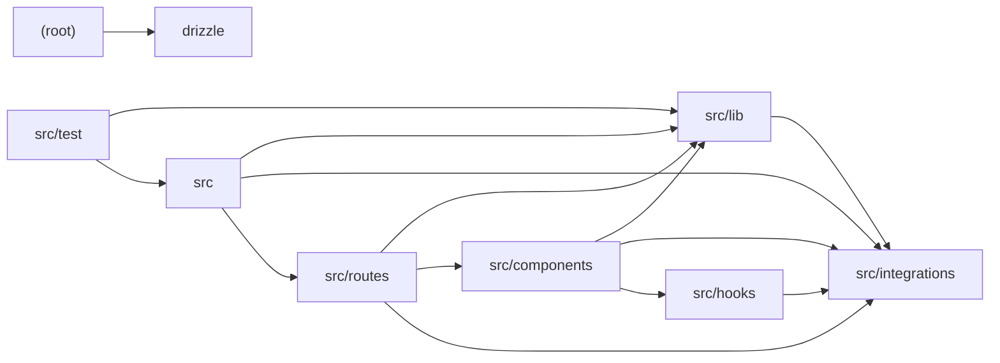

# Architecture

Hej Copenhagen is a TanStack Start (React + TanStack Router/Query) application deployed via Vite/Nitro on Vercel, offering a Denmark travel guide with static content pages (visa, currency, cities, culture, history) and authenticated AI features: a streaming RAG-augmented chat assistant and a schema-constrained trip planner. Supabase provides auth and persistence (chat_messages, trips), OpenRouter supplies LLM chat, JSON completion, and embeddings, and a shadcn/ui-style component library (Radix + CVA + Tailwind) plus `ai-elements` components render the UI. Root config files manage Drizzle migrations, ESLint, Vite, and Vitest; `src/test` covers routing, currency math, and knowledge scoring.

## Modules

| module | summary | AI |
| --- | --- | --- |
| `(root)` | Build, lint, test, and DB migration configuration (Vite/TanStack Start, ESLint, Vitest, Drizzle). | — |
| `drizzle` | Placeholder for auto-generated Drizzle schema definitions. | — |
| `src` | Router creation, TanStack Start instance with auth/CSRF/error middleware, and SSR server fetch entry. | — |
| `src/components` | Shared layout components, AI chat UI elements (conversation, message, prompt input, shimmer), and shadcn/ui-style Radix primitives. | [AI] |
| `src/hooks` | React hooks for mobile breakpoint detection and Supabase session state with router invalidation. | — |
| `src/integrations` | Supabase client/server setup, auth-attaching middleware, cron request verification, and database types. | — |
| `src/lib` | Core utilities, static travel data, error handling, and server-side AI (OpenRouter streaming/JSON/embeddings, RAG retrieval, chat and planner handlers). | [AI] |
| `src/routes` | File-based routes: root layout, public guide pages, authenticated AI chat and planner, auth flow, and /api/chat endpoint. | [AI] |
| `src/test` | Vitest setup and unit tests for routing, currency conversion, and knowledge scoring. | — |

## Module dependencies

_`[AI]` marks modules with AI/LLM touchpoints (prompt files, model API calls, agent logic)._
