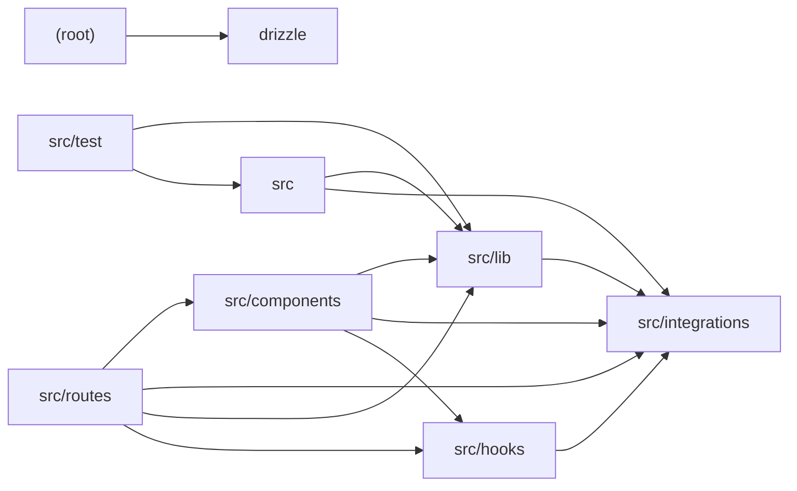

# Architecture

A TanStack Start (Vite + Nitro/Vercel) full-stack React application serving as a Denmark travel guide. Public informational routes (visa, currency, cities, culture, history) are complemented by authenticated AI features: a streaming RAG-augmented chat guide and a schema-constrained itinerary planner. Supabase provides auth and persistence (chat_messages, trips), OpenRouter supplies LLM chat/JSON completions and embeddings, and an in-memory knowledge base with vector + keyword scoring powers retrieval. The UI is built from shadcn/ui-style Radix primitives plus 'ai-elements' chat components. Root config files handle Drizzle migrations, ESLint, Vite, and Vitest; src/test covers routing, currency math, and knowledge scoring.

## Modules

| module | summary | AI |
| --- | --- | --- |
| `(root)` | Build, lint, test, and database-migration configuration files. | — |
| `drizzle` | Placeholder for auto-generated Drizzle schema definitions. | — |
| `src` | Router creation, TanStack Start instance with auth/CSRF/error middleware, and SSR server fetch entry. | — |
| `src/components` | Radix/CVA/Tailwind UI primitives, site layout components, and AI chat elements (conversation, message, prompt input, shimmer). | [AI] |
| `src/hooks` | useIsMobile breakpoint hook and useSession Supabase auth-state hook with router invalidation. | — |
| `src/integrations` | Supabase clients, auth middleware/attacher, cron request verification, and generated DB types. | — |
| `src/lib` | Utilities, static travel data, error handling, and server-side AI (OpenRouter streaming/JSON, RAG retrieval, chat and planner handlers). | [AI] |
| `src/routes` | TanStack Router file-based routes: root shell, public guides, auth, authenticated chat/planner, and /api/chat endpoint. | [AI] |
| `src/test` | Vitest setup and unit tests for routing, currency, and knowledge scoring. | — |

## Module dependencies

_`[AI]` marks modules with AI/LLM touchpoints (prompt files, model API calls, agent logic)._
