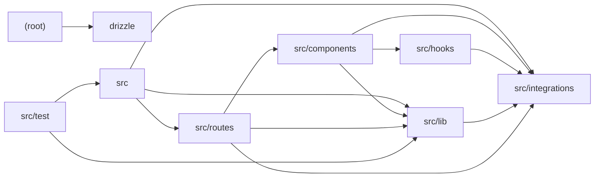

# Architecture

Hej Copenhagen is a TanStack Start (React + Vite) travel-guide application for Denmark, deployed via Nitro/Vercel presets. Static guide pages (visa, currency, cities, culture, history) live in `src/routes`, alongside authenticated AI experiences: a streaming RAG-backed chat assistant (`/chat` and the `/api/chat` POST endpoint) and a schema-constrained trip planner (`/planner`). Server-side AI logic in `src/lib` talks to OpenRouter for chat streaming, JSON completions, and embeddings, and retrieves context from an in-memory knowledge base using combined vector and keyword scoring. Supabase provides auth (client/server clients, bearer-token attaching middleware, cron secret verification) and persistence for chat history and trips, with type definitions in `src/integrations/supabase/types.ts` and a Drizzle config pointing at a currently empty generated schema. The UI layer is a shadcn/ui-style library of Radix + CVA + Tailwind primitives in `src/components/ui`, plus AI-specific chat components (conversation, message with Streamdown markdown, prompt input, shimmer) in `src/components/ai-elements`. Root-level files wire up the router with a shared QueryClient, the TanStack Start instance with CSRF/auth/error middleware, and an SSR fetch entry with error-page fallbacks. Vitest with jsdom covers routing, currency math, and knowledge scoring.

## Modules

| module | summary | AI |
| --- | --- | --- |
| `(root)` | Build, lint, test, and Drizzle migration configuration files for the Vite/TanStack Start app. | — |
| `drizzle` | Placeholder for auto-generated Drizzle ORM schema definitions (currently empty). | — |
| `src` | Router creation, TanStack Start instance with auth/CSRF/error middleware, and the SSR server fetch entry. | — |
| `src/components` | Shared layout components, AI chat UI elements (conversation, message, prompt input, shimmer), and shadcn-style Radix/CVA primitives. | [AI] |
| `src/hooks` | React hooks for mobile breakpoint detection and Supabase session state with router invalidation. | — |
| `src/integrations` | Supabase client/server clients, auth-attaching middleware, cron request verification, and database types. | — |
| `src/lib` | Core utilities, static travel data, currency math, error handling, and server-side OpenRouter/RAG AI integrations. | [AI] |
| `src/routes` | TanStack Router file-based routes: static guide pages, authenticated AI chat and planner views, auth flow, and the /api/chat endpoint. | [AI] |
| `src/test` | Vitest setup and unit tests for routing, currency conversion, and knowledge search scoring. | — |

## Module dependencies

_`[AI]` marks modules with AI/LLM touchpoints (prompt files, model API calls, agent logic)._
