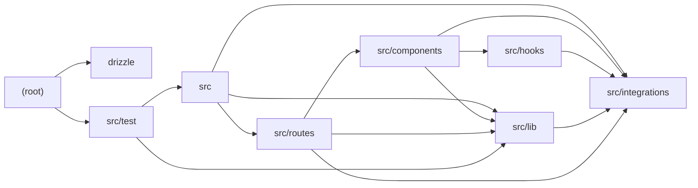

# Architecture

Hej Copenhagen is a TanStack Start (React + TanStack Router + React Query) travel-guide application deployed via Vite/Nitro on Vercel, backed by Supabase (auth, Postgres via Drizzle) and OpenRouter for LLM features. The root holds build/lint/test/migration configs. `src` wires the router, SSR fetch entry, and Start instance with Supabase auth-attaching, CSRF, and error middleware. `src/routes` provides file-based routes: static guide pages (visa, currency, cities, culture, history), an `_authenticated` layout gating the AI chat (`/chat`) and trip planner (`/planner`), an `/auth` page, and a `/api/chat` POST endpoint. `src/lib` contains the AI core — an OpenRouter server client (streaming chat, schema-constrained JSON, embeddings), a RAG retriever over an in-memory Denmark knowledge base combining vector and keyword scoring, a chat request handler persisting history to Supabase, and a `createTripPlan` server function — plus static city/currency data, error capture/reporting, and the `cn` utility. `src/components` offers shadcn/ui-style Radix primitives, site layout pieces, and AI chat elements (Conversation, Message with Streamdown markdown, PromptInput, Shimmer). `src/hooks` supplies `useIsMobile` and `useSession`; `src/integrations` holds Supabase clients, auth middleware, cron auth, and generated DB types; `src/test` holds Vitest suites and setup.

## Modules

| module | summary | AI |
| --- | --- | --- |
| `(root)` | Drizzle, ESLint, Vite/TanStack Start, and Vitest configuration files. | — |
| `drizzle` | Placeholder for auto-generated Drizzle schema definitions. | — |
| `src` | Router creation, SSR server fetch entry, and TanStack Start instance with auth/CSRF/error middleware. | — |
| `src/components` | shadcn/ui Radix primitives, site header/footer/hero, and AI chat elements (conversation, message, prompt input, shimmer). | [AI] |
| `src/hooks` | React hooks for mobile breakpoint detection and Supabase session state with router invalidation. | — |
| `src/integrations` | Supabase client/server instances, auth middleware, cron request verification, and generated DB types. | — |
| `src/lib` | OpenRouter client, RAG retrieval, chat/planner server logic, static travel data, currency math, error utilities, and cn(). | [AI] |
| `src/routes` | File-based TanStack routes: guide pages, authenticated AI chat and planner, auth flow, root layout, and /api/chat endpoint. | [AI] |
| `src/test` | Vitest setup and unit tests for routing, currency, and knowledge scoring. | — |

## Module dependencies

_`[AI]` marks modules with AI/LLM touchpoints (prompt files, model API calls, agent logic)._
