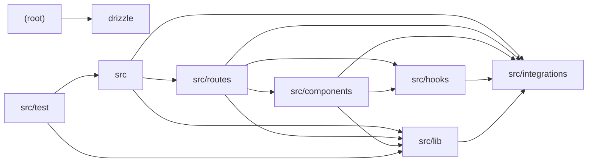

# Architecture

Hej Copenhagen is a Denmark travel guide built on TanStack Start (React, TanStack Router, React Query) with Vite, deployed via a Vercel Nitro preset. The root holds Drizzle, ESLint, Vite and Vitest configs. `src` bootstraps the router, server fetch entry (with catastrophic-error normalization to HTML error pages) and the Start instance with CSRF, Supabase auth, and error middleware. `src/routes` defines file-based pages (cities, currency, history, people, visa), an `_authenticated` guard layout hosting the AI chat and trip planner, and an `/api/chat` streaming endpoint. `src/lib` is the domain and AI core: static Denmark knowledge/cities/currency data, OpenRouter client (streaming chat, JSON-schema completions, embeddings), hybrid RAG retrieval, the chat request handler, and the `createTripPlan` server function persisting to Supabase. `src/components` provides shadcn-style Radix/Tailwind UI primitives, site layout, and Vercel AI SDK-oriented chat elements. `src/integrations` wraps Supabase (types, auth token attachment, cron auth), `src/hooks` offers mobile and session hooks, and `src/test` covers routing, currency, and knowledge ranking with Vitest/jsdom.

## Modules

| module | summary | AI |
| --- | --- | --- |
| `(root)` | Build, lint, test, and Drizzle migration configuration for the TanStack Start + Vite app. | — |
| `drizzle` | Auto-generated Drizzle ORM schema placeholder (currently blank). | — |
| `src` | App bootstrap: router with React Query, server fetch entry with error normalization, and Start middleware (CSRF, Supabase auth, errors). | — |
| `src/components` | Site layout, Radix/Tailwind UI primitives, and AI chat elements (conversation, message, prompt input). | [AI] |
| `src/hooks` | Client hooks for mobile breakpoint detection and Supabase session tracking with router invalidation. | — |
| `src/integrations` | Supabase types, client auth-token middleware for server functions, and timing-safe cron auth. | — |
| `src/lib` | Domain data, error capture, and the AI/RAG pipeline: OpenRouter client, retrieval, chat streaming, itinerary planning. | [AI] |
| `src/routes` | File-based routes: guide pages, auth, authenticated AI chat and planner UIs, and the /api/chat endpoint. | [AI] |
| `src/test` | Vitest setup and tests for routing, currency conversion, and knowledge ranking. | — |

## Module dependencies

_`[AI]` marks modules with AI/LLM touchpoints (prompt files, model API calls, agent logic)._
