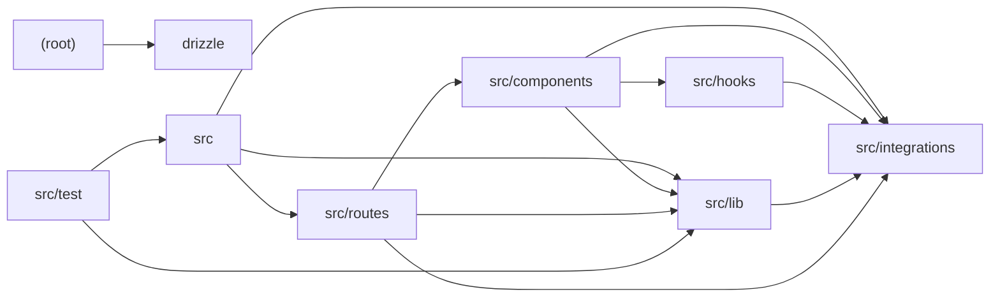

# Architecture

A Denmark travel-guide web application built on TanStack Start (SSR) with TanStack Router and React Query on the client, Supabase for authentication and persistence, and an OpenRouter-backed AI layer providing a RAG-augmented streaming chat guide and a schema-constrained itinerary planner. The UI is composed of shadcn/ui-style Radix primitives plus dedicated AI chat elements (conversation, message, prompt input, shimmer). Root configs wire Drizzle migrations, ESLint, Vite/Nitro (Vercel), and Vitest; the test module covers routing, currency math, and knowledge scoring.

## Modules

| module | summary | AI |
| --- | --- | --- |
| `(root)` | Build, lint, test, and Drizzle migration configuration files. | — |
| `drizzle` | Placeholder for auto-generated Drizzle database schema. | — |
| `src` | Router creation, TanStack Start instance with auth/CSRF/error middleware, and SSR server fetch entry. | — |
| `src/components` | Shared layout components, Radix/CVA UI primitives, and AI chat elements (conversation, message, prompt input, shimmer). | [AI] |
| `src/hooks` | React hooks for mobile breakpoint detection and Supabase session state with router invalidation. | — |
| `src/integrations` | Supabase client/server setup, auth middleware, database types, and cron request verification. | — |
| `src/lib` | Utilities, static travel data, error handling, and server-side AI (OpenRouter streaming, JSON planning, RAG retrieval). | [AI] |
| `src/routes` | File-based routes: root layout, public info pages, auth, and authenticated AI chat/planner plus /api/chat endpoint. | [AI] |
| `src/test` | Vitest setup and unit tests for routing, currency, and knowledge scoring. | — |

## Module dependencies

_`[AI]` marks modules with AI/LLM touchpoints (prompt files, model API calls, agent logic)._
