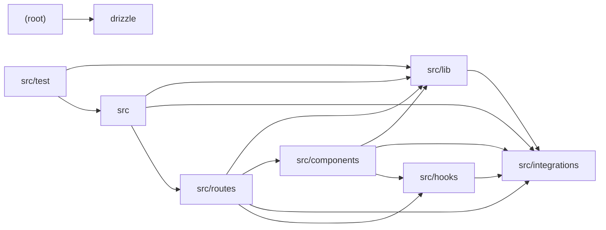

# Architecture

Hej Guide is a TanStack Start (React + TanStack Router/Query, Vite, Nitro on Vercel) travel-guide web app for Denmark. Root config files define Drizzle migrations, ESLint, Vite/TanStack Start, and Vitest. The `src` module boots the router, server fetch entry, and Start instance with Supabase auth, CSRF, and error middleware. File-based routes in `src/routes` render static travel guides (cities, currency, history, people, visa), a Supabase auth page, and authenticated AI features (streaming chat and structured itinerary planner) backed by an `/api/chat` server route. `src/lib` holds domain data (cities, currency, knowledge base) plus server-only AI orchestration: an OpenRouter client for streaming, schema-constrained JSON completion and embeddings, a hybrid vector/keyword RAG retriever, and chat/planner handlers that persist to Supabase. `src/components` provides shadcn/ui-style Radix + CVA + Tailwind primitives, site layout components, and `ai-elements` chat UI (conversation, message with Streamdown markdown, prompt input, shimmer). `src/integrations` wraps Supabase clients, auth middleware, database types, and cron auth; `src/hooks` provides responsive and session hooks; `src/test` contains Vitest suites for routing, currency, and knowledge scoring.

## Modules

| module | summary | AI |
| --- | --- | --- |
| `(root)` | Root configuration for Drizzle migrations, ESLint, Vite/TanStack Start build, and Vitest. | — |
| `drizzle` | Placeholder for auto-generated Drizzle database schema definitions. | — |
| `src` | Router creation, SSR server fetch entry with error fallbacks, and TanStack Start instance with auth/CSRF/error middleware. | — |
| `src/components` | shadcn/ui-style Radix primitives, site layout components, and AI chat UI elements (conversation, message, prompt input, shimmer). | [AI] |
| `src/hooks` | React hooks for mobile breakpoint detection and Supabase session state with router invalidation. | — |
| `src/integrations` | Supabase client/server setup, auth middleware, database types, and cron request authentication. | — |
| `src/lib` | Domain data, utilities, error handling, and server-side AI orchestration (OpenRouter streaming, schema-constrained planning, RAG retrieval). | [AI] |
| `src/routes` | File-based TanStack Router pages, authenticated AI chat/planner routes, and the /api/chat server endpoint. | [AI] |
| `src/test` | Vitest setup and unit tests for routing, currency math, and knowledge search scoring. | — |

## Module dependencies

_`[AI]` marks modules with AI/LLM touchpoints (prompt files, model API calls, agent logic)._
