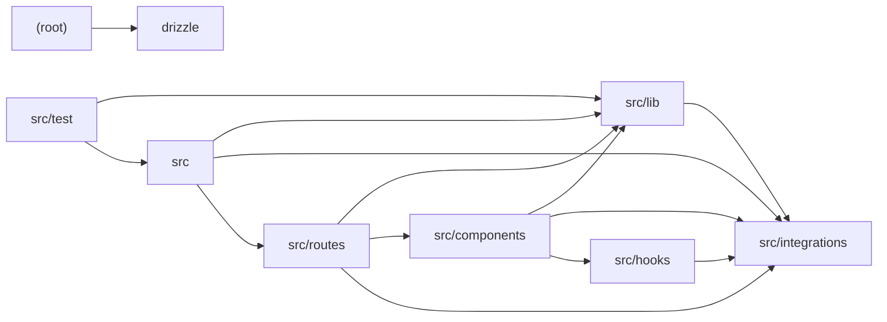

# Architecture

Hej Guide is a Denmark travel-guide web application built on TanStack Start (SSR via Vite/Nitro, deployed to Vercel) with TanStack Router and React Query on the client. Root configs wire up Drizzle migrations, ESLint, Vite, and Vitest. The `src` entry layer creates the router, configures the Start instance with Supabase auth-attaching, CSRF, and error middleware, and exposes the SSR fetch handler. `src/routes` defines static informational pages (cities, currency, history, people, visa), Supabase-backed auth, and protected AI features: a streaming RAG chat (via `/api/chat`) and a schema-constrained trip planner server function. `src/lib` hosts the server-side AI stack (OpenRouter streaming/JSON/embeddings, RAG retrieval over an in-memory knowledge base) plus currency math, static city data, and error utilities. `src/components` provides shadcn/ui-style Radix primitives, site chrome, and AI chat UI elements built on the `ai` SDK and Streamdown. `src/integrations` wraps Supabase clients, generated DB types, auth middleware, and cron verification; `src/hooks` supplies responsive and session hooks; `src/test` covers routing, currency, and knowledge scoring with Vitest.

## Modules

| module | summary | AI |
| --- | --- | --- |
| `(root)` | Drizzle, ESLint, Vite/TanStack Start, and Vitest configuration files. | — |
| `drizzle` | Placeholder for auto-generated Drizzle schema definitions. | — |
| `src` | Router creation, TanStack Start instance with auth/CSRF/error middleware, and SSR server entry. | — |
| `src/components` | Radix/CVA/Tailwind UI primitives, site header/footer/hero, and AI chat elements (conversation, message, prompt input, shimmer). | [AI] |
| `src/hooks` | useIsMobile breakpoint hook and useSession Supabase auth-state hook with router invalidation. | — |
| `src/integrations` | Supabase client/server instances, auth middleware, DB types, and cron request verification. | — |
| `src/lib` | OpenRouter client, RAG retrieval, chat/planner server logic, currency and city data, error utilities, cn helper. | [AI] |
| `src/routes` | File-based TanStack Router pages, protected AI chat/planner routes, auth page, and /api/chat server route. | [AI] |
| `src/test` | Vitest setup and unit tests for routing, currency, and knowledge scoring. | — |

## Module dependencies

_`[AI]` marks modules with AI/LLM touchpoints (prompt files, model API calls, agent logic)._
