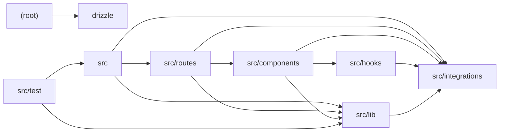

# Architecture

Hej Copenhagen is a TanStack Start (React + Vite) travel-guide application for Denmark with SSR, Supabase authentication/persistence, and an AI layer built on OpenRouter. Root configs (Drizzle, ESLint, Vite/Nitro for Vercel, Vitest) sit at the top level; `src` wires the router, server fetch entry, and Start instance with CSRF/auth/error middleware. File-based routes in `src/routes` render public guide pages and an authenticated chat and trip planner, delegating to `src/lib` for static travel data, currency math, error handling, and server-only AI code (streaming chat, schema-constrained JSON itineraries, RAG retrieval over an in-memory knowledge base). `src/components` holds shadcn/ui-style Radix primitives plus `ai-elements` streaming-chat components; `src/hooks` and `src/integrations` provide session/breakpoint hooks and Supabase client/server/cron utilities. `src/test` covers routing, currency, and knowledge scoring with Vitest.

## Modules

| module | summary | AI |
| --- | --- | --- |
| `(root)` | Build, lint, test, and database-migration configuration (Vite/TanStack Start, ESLint, Vitest, Drizzle). | — |
| `drizzle` | Placeholder for auto-generated Drizzle schema definitions. | — |
| `src` | Router creation, SSR server fetch entry with error fallbacks, and TanStack Start instance with auth/CSRF/error middleware. | — |
| `src/components` | Shared layout components, Radix/CVA/Tailwind UI primitives, and AI chat elements (conversation, message, prompt input, shimmer). | [AI] |
| `src/hooks` | React hooks for mobile breakpoint detection and Supabase session state with router invalidation. | — |
| `src/integrations` | Supabase client/server instances, auth middleware, database types, and cron request verification. | — |
| `src/lib` | Utilities, static travel/currency data, error capture, and server-side AI (OpenRouter streaming, JSON planning, RAG retrieval). | [AI] |
| `src/routes` | File-based routes for public guide pages, authenticated chat and planner, auth page, and the /api/chat server endpoint. | [AI] |
| `src/test` | Vitest setup and unit tests for routing, currency conversion, and knowledge scoring. | — |

## Module dependencies

_`[AI]` marks modules with AI/LLM touchpoints (prompt files, model API calls, agent logic)._
